# Deltora Quest DS Patcher

An English translation and enhancement of **Deltora Quest: Nanatsu no Houseki** (デルトラ・クエスト 七つの宝石), the 2007 Nintendo DS action RPG based on Emily Rodda's books, released only in Japan.

This repository builds the English ROM from your own copy of the Japanese game. It contains only the patches: the translation, our own ARM code and script changes, and the tools that apply them. It contains no code, graphics, text or sound from the original game.

The patched game can be played on a real DS or in an emulator, and the whole game can be played with the buttons instead of the stylus.

## Screenshots

<table>
<tr>
<td>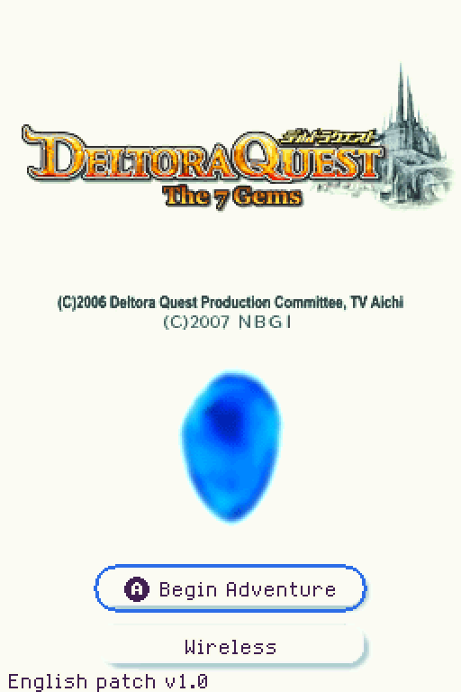</td>
<td>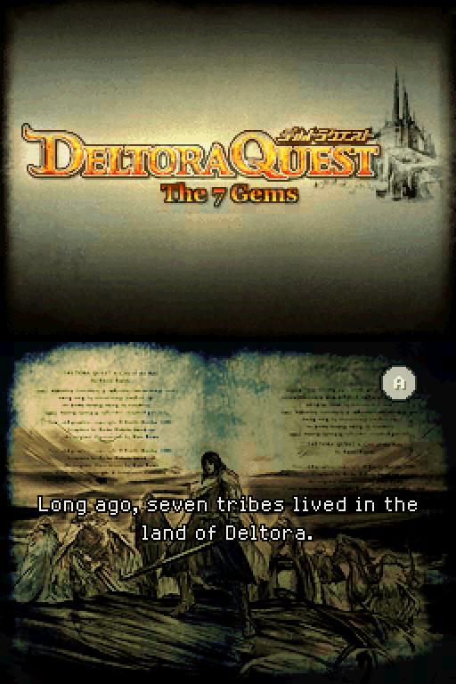</td>
<td>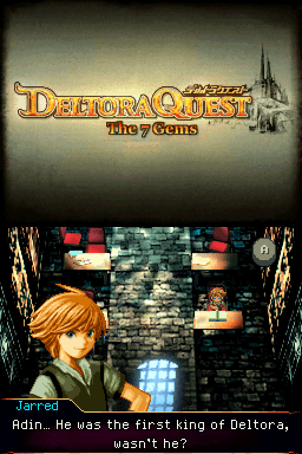</td>
<td>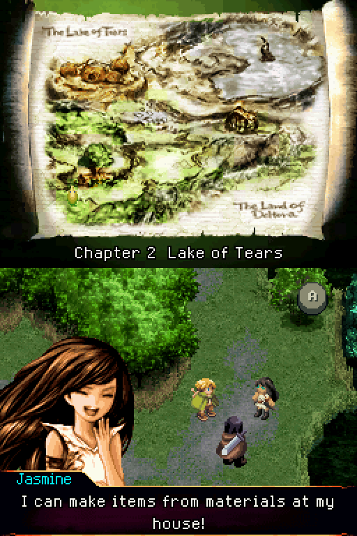</td>
</tr>
<tr>
<td>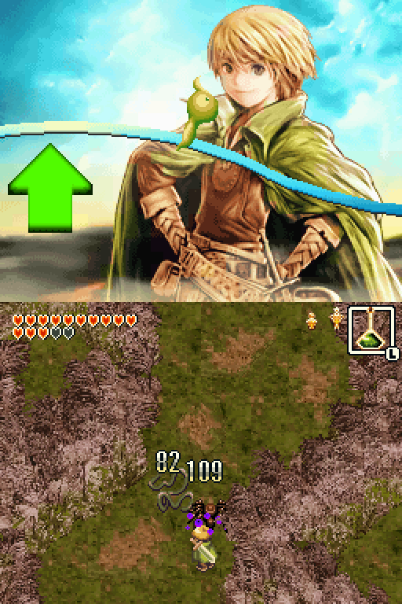</td>
<td>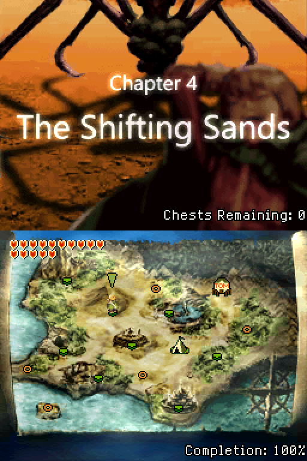</td>
<td>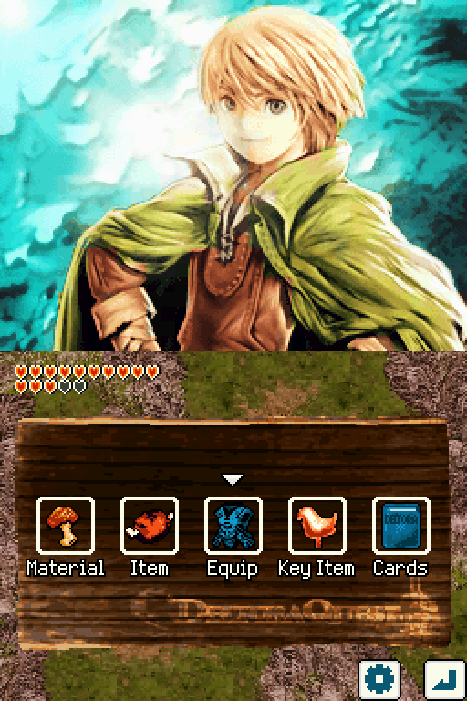</td>
<td>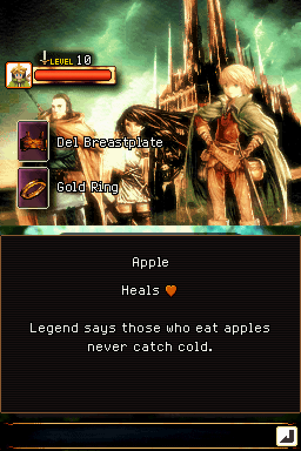</td>
</tr>
<tr>
<td>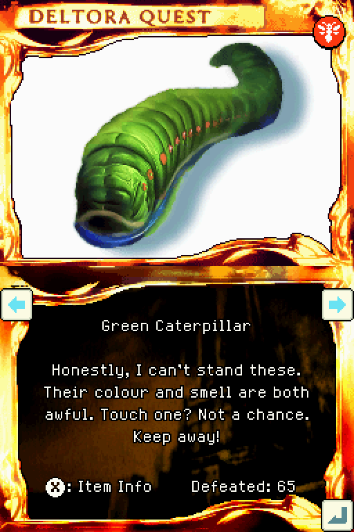</td>
<td>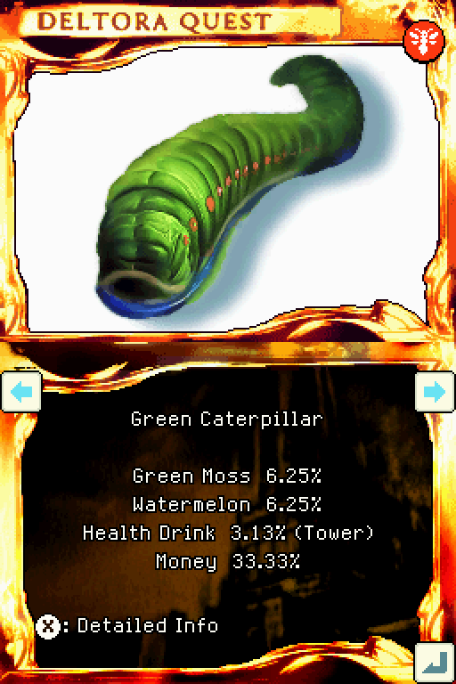</td>
<td>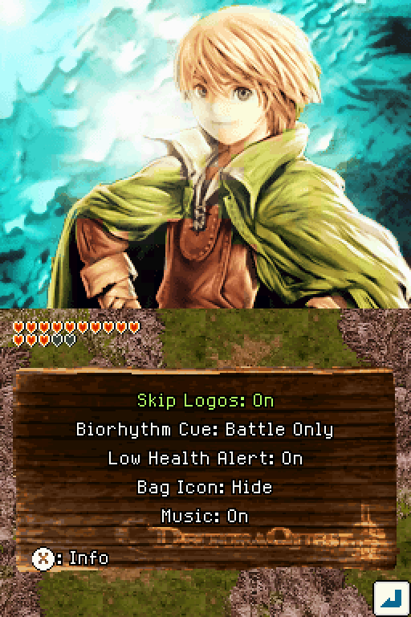</td></tr>
</table>

## Patching your ROM

The easiest way is the web patcher at **https://vortyne.github.io/Deltora-DS-patcher/**:
- choose your Japanese ROM;
- it checks the ROM and applies the patch in your browser;
- you save the English ROM.

Nothing is uploaded.

The patch itself, `Deltora_Quest_DS_english_patch_full_button_control_v<version>.bps`, is attached to the [latest release](https://github.com/Vortyne/Deltora-DS-patcher/releases/latest). It also works with any BPS patcher, such as Floating IPS.

## Building

To build the ROM from source instead, you need:

- **Your own dump of the Japanese ROM.** The builder checks it:
  - SHA-1 `5a28815f68e78e2da5b486951a158a374150e459`
  - 134,217,728 bytes
- **Python 3** (tested with 3.12), with the packages in `requirements.txt`:

  ```
  pip install -r requirements.txt
  ```

- **The fonts Segoe UI, Arial and Georgia.** A few redrawn graphics, such as the title subtitle and the card and move titles, are drawn with them. Windows has them in `C:\Windows\Fonts`, which is where the builder looks. They can't be shipped here, so on another system point `DELTORA_FONTS` at a folder that has them.

Then run:

```
python build.py path/to/baserom.nds
```

The English ROM is written to `out/Deltora_Quest_DS_english_patch_full_button_control_v<version>.nds`; use `-o` to choose another path. The first run unpacks the game's files into `work/`, and later runs reuse them. Both `work/` and `out/` are ignored by git.

### Releasing a version

1. Set the version in `version_number.txt`, for example `1.0`. It's shown on the title screen as "English patch v1.0", and it names the patch.
2. Run `python release.py path/to/baserom.nds`. It builds the ROM into `out/` and writes the patch, `docs/Deltora_Quest_DS_english_patch_full_button_control_v1.0.bps`, after checking that the patch rebuilds the ROM exactly. It removes any older version's patch from `docs/`. With the ROM under its standard name, `Deltora Quest - Nanatsu no Houseki (Japan).nds`, next to `release.py`, the path can be left out.
3. Commit and push the patch in `docs/`. It's the only release file kept in the repository: the web patcher needs it on its own site.
4. Publish a GitHub release tagged `v1.0`, with the same `.bps` attached.

Pushing the patch runs `.github/workflows/pages.yml`, which deploys the web patcher from `docs/` together with `version_number.txt`. The page downloads the patch from its own site, since browsers can't download GitHub release files directly.

The site's [translation page](https://vortyne.github.io/Deltora-DS-patcher/translation.html) shows every English line, and its **Suggest a change** button opens a filled-in *Translation tweak* issue. Its text is made by `tools/export_translation.py` from `translation/` at each deploy, and any push that changes `translation/` deploys again, so the page always matches the patch. It shows only the English: the game's Japanese script isn't published.

GitHub Pages must be set to deploy from **GitHub Actions** (in **Settings → Pages**).

## What's changed

### Translation

The game's text was first machine translated, then heavily proofread by hand, line by line, so it reads naturally and flows from one line to the next. Names and terms follow Emily Rodda's books. If a line still reads oddly, suggest a better one on the [translation page](https://vortyne.github.io/Deltora-DS-patcher/translation.html).

- **All text in English:** the story, menus, items, cards, notes, help and credits. The only text left in Japanese is the developers' internal debug menus.
- **New English font:**
  - variable width, hand-drawn in the style of the game's own;
  - two-letter glyphs, so long item and card names fit the game's fixed-length name fields.
- **Redrawn graphics:** the title subtitle, *The 7 Gems*, in the original fiery style, and the chapter and stage title cards, Yes/No labels, menu labels, name plates, special move titles, the game over line and the title copyright line.

### Playing with the buttons

Everything that needed the stylus now also works with the D-pad and buttons. The stylus still works everywhere. A couple of small minigames still utilize only the stylus, or the DS microphone.

- **Field:** the original game is played with the stylus: tap to walk, tap an enemy to attack, and shout into the microphone for a special move. Every one of these now has a button.

  | Button | What it does |
  |---|---|
  | D-pad | Walk, sliding along walls |
  | B held | Run |
  | Y | Attack the nearest enemy |
  | X held | Charge, then release to dash-attack, where the game allows dash attacks |
  | R held | Special move, at a biorhythm peak, in place of shouting into the microphone |
  | L | Use the item in the item square |
  | Select | Switch to the next item |
  | A | Talk, or open a chest |
  | Start | Open the bag |

  - In the original game, the item in the item square couldn't be changed at all. Select now brings the next item into the square, so items can be swapped mid-fight.  - A talks to whoever Lief is facing, preferring the more useful person when two are in reach (the Grand Farm's farmer over his dog).
  - Some map collisions were adjusted so diagonal corridors don't snag.
- **Menus:** the D-pad cursor works in the bag, item lists, the card book, the shop, the smith, the mixing room and the options. L and R switch tabs, and every bag icon has a label.
- **Camp:** D-pad and buttons throughout: X saves, Y changes hero, A chooses.
- **World map:** the D-pad moves between places.
- **Minigames and puzzles:** Most minigames can be played with the buttons instead of just the stylus.
### Quality of life

- **Options page** (a gear button in the bag): skip the opening logos, the biorhythm voice cue, the low-health alarm, the bag icon, and music on/off.
- **Saving**
  - No fixed "Saving…" wait.
  - The campfires after the Tower of Illusion's boss floors now allow saving, and the file screen shows the floor ("Tower of Illusion 40F").
  - B on the file screen returns to the title menu.
- **File screen:** shows each file's play time and completion percentage.
- **Card book**
  - Item Info lists each enemy's drops with their chances.
  - Detailed Info gives HP and where the enemy is found, with Tower of Illusion variants marked.
  - Kill counts are kept for every enemy.
  - After the game is cleared, an unfound card shows where to find it.
  - The hexagon only animates when a new card was added.
- **Card drops:** in the original game every card was pure luck; now each enemy's kill count decides it.
  - From the 10th defeat of an enemy, it always drops its card until you have it. Before then, it can still drop at its normal chance.
  - In the original game, when an enemy dropped a card you already owned, 1 time in 128 it was the gold version instead. Now no gold card is left to chance: defeat 50 of an enemy, with its card owned, and its card turns gold.
- **Item drops:** rare crafting materials and gear drop at least 6.25% of the time (12.5% for the Poncho).
- **Grand Farm**
  - You choose the crop.
  - Fields grow every hour away instead of every day, and are ruined after three days instead of two.
  - A signpost explains this.
- **Jasmine's mixing room**
  - No stirring needed, and results stay on screen until A.
  - After the game is cleared, a signpost lists the four gear recipes no recipe item teaches.
- **Smith:** each material's count is shown.
- **Final Slash:** Lief's Final Slash attack plays faster than before.
- **World map, after a chapter is cleared:**
  - its place shows how many chests are left;
  - once the game is cleared, the touch screen shows the completion percentage.
- **Completion** is weighted as follows. Each part counts in proportion, and the total rounds down.

  | Part | Weight |
  |---|---|
  | Main chapters and the ending | 50% |
  | Items, equipment, recipes, key items and chests | 5% each |
  | Cards | 15% |
  | Clearing the Tower of Illusion | 5% |
  | Clearing Mokeet's Mansion | 5% |

- **Ending:** the first clear announces the Tower of Illusion, and the final screen offers a return to the title.

### Fixes

- **Graphics**
  - In Mokeet's Mansion's auto-scrolling rooms, Lief stays fully on screen.
  - Returning from a save point no longer leaves Lief stuck on a wall in Mokeet's Mansion.
- **Gameplay**
  - Pumpkin Soup no longer resets a hero's biorhythm to the bottom when it wears off.
  - With protective boots on, Lief can attack on spikes and similar floors. Previously, the game would not allow attacking even with these boots being worn.
  - The low-health alarm stops after three beeps and repeats now and then.

### Diagnostics

Each save records the game's lowest free memory and any failed memory allocations, in bytes the game never uses. This helps track down crashes reported by players.

## How it works

The original game is never rebuilt from source. `build.py` unpacks the game's archive of files, and `builder/make_rom.py` then applies three kinds of change:

| Change | How it's made |
|---|---|
| Game code | New ARM code, assembled with Keystone, goes in a block added to the ARM9 binary. The game's own code branches into it at specific addresses. |
| Game scripts | The game's SCR0 event scripts get new functions and patched calls, written as script bytecode. |
| Files | Text banks are re-encoded from `translation/en`, graphics are redrawn, and data tables are edited. |

The game's archive is rebuilt, with changed files moved to the end where they don't fit in place.

| Path | Contents |
|---|---|
| `build.py` | Entry point: checks the ROM, unpacks it and runs the builder |
| `builder/make_rom.py` | Applies every patch and writes the ROM |
| `builder/controls/` | The ARM code and script patches, split by feature |
| `builder/card_patch.py`, `title_patch.py` | Redrawn graphics |
| `builder/entext.py`, `pixelfont.py`, `itemdb.py`, `translate.py` | Font, text encoding and line layout |
| `builder/cardinfo.py`, `drops.py`, `talk.py`, `mapfix.py` | Card book data, drop rates, talk ranges and map collision fixes, worked out from the game's own data |
| `builder/build_rom.py`, `lf2.py`, `scr.py` | ROM, archive and script formats |
| `translation/en/` | The English text, one file per text bank |
| `translation/adjustments.json` | Hand adjustments to individual lines |
| `translation/glossary.md` | Spellings and naming decisions for the translation |

The files in `builder/controls/` share one namespace: `__init__.py` loads them in order, so each feature's assembly can use names from the others.

| File | Contents |
|---|---|
| `core.py` | The code block and its install, shared hooks, script helpers |
| `field.py` | Walking, talking, attacking, the HUD |
| `menus.py` | Cursors, item lists, prompts |
| `options_and_title.py` | The options page, title menu and save screen |
| `shop_and_mixing.py` | Tom's Shop, the mixing room, the smith |
| `camp.py` | The camp and saving |
| `cards.py` | The card book |
| `minigames.py` | The quiz, Belt puzzle, farm and Disposal Pit |
| `world_map.py` | World map travel, chests remaining, completion |
| `file_screen.py` | Play time, completion and the Tower floor on the file screen |
| `story_scripts.py` | The ending, the Tower's rest rooms, the sound test, signs |

## Was AI used?

| | |
|---|:-:|
| Generating art | ❌ |
| Generating music | ❌ |
| Writing code | ✅ |

## Legal

This project's code and translation are licensed under the [GNU General Public License v3.0](LICENSE).

Deltora Quest is © Emily Rodda. The game is © its publishers and developers. This project is not affiliated with them. It distributes no part of the game, and building requires a ROM you dumped from a cartridge you own.
